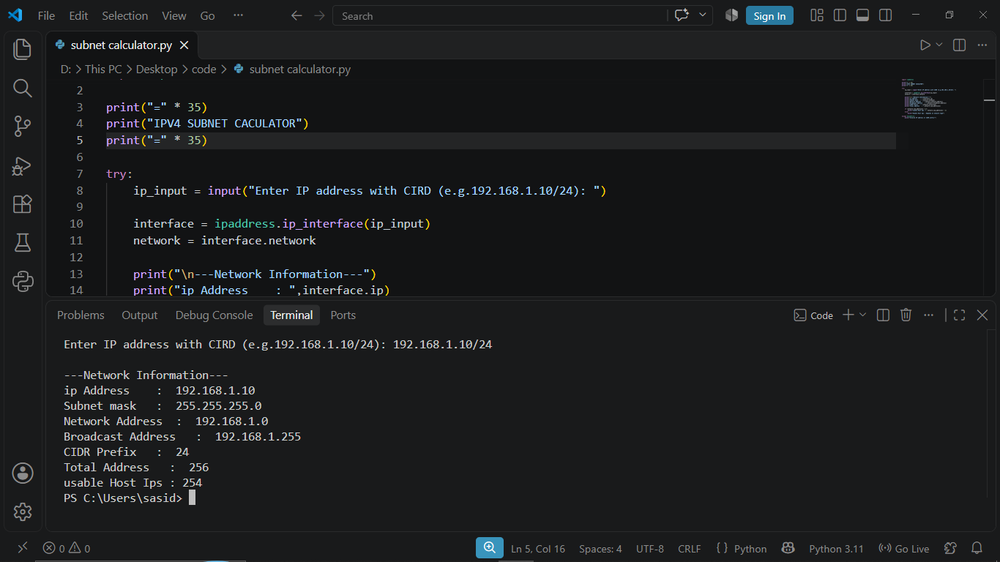

# Python IPv4 Subnet Calculator


<table>
  <tr>
    <td align="center">
      
    </td>
  </tr>
</table>

A beginner-friendly Python networking project that calculates IPv4 subnet information using Python's built-in `ipaddress` module.

## Project Overview

The IPv4 Subnet Calculator is a command-line tool designed to calculate important network details from an IPv4 address and CIDR prefix.

## Features

- IPv4 address validation
- Subnet mask calculation
- Network address identification
- Broadcast address calculation
- CIDR prefix detection
- Total IP address calculation
- Usable host address calculation
- Invalid input handling

## Technologies Used

- Python 3
- ipaddress module
- VS Code

## Installation

1. Clone this repository:

```bash
git clone https://github.com/Sasidu-Tech/Python-IPv4-Subnet-Calculator.git
```

2. Open the project folder.

3. Run the program:

```bash
python subnet_calculator.py
```

## Example Input

```text
192.168.1.10/24
```

## Example Output

```text
IPv4 SUBNET CALCULATOR

IP Address        : 192.168.1.10
Subnet Mask       : 255.255.255.0
Network Address   : 192.168.1.0
Broadcast Address : 192.168.1.255
CIDR Prefix       : 24
Total Addresses   : 256
Usable Host IPs   : 254
```

## Python Concepts Practiced

- Variables
- User Input
- Conditional Statements
- Try-Except Error Handling
- Python Modules
- IP Address Calculations

## Learning Objectives

- Understand IPv4 addressing.
- Learn subnet masks and CIDR notation.
- Identify network and broadcast addresses.
- Practice Python networking concepts.

## Author

**Sasidu Wishshanka**

BICT Undergraduate | Rajarata University of Sri Lanka

GitHub: https://github.com/Sasidu-Tech

LinkedIn: https://www.linkedin.com/in/sasidu-wishshanka-434938428

## License

This project is licensed under the MIT License.
